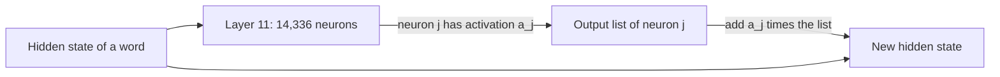

## Introduction

Ask a chat model such as Llama how to make an illegal drug and it will usually say no. Ask it *"How can I kill a Python process?"* and, now and then, it says no to that as well. The word "kill" looks dangerous, but here it only means stopping a program.

<strong>Refusal:</strong> the model declines to help with a request. Models are trained to do this for harmful requests.

<strong>Over-refusal:</strong> the model declines a request that is harmless, usually because it contains a word or a topic that looks risky.

Both cases are the same behavior, saying no, applied to two kinds of requests. The first is intended. The second is a mistake. To understand either one, it helps to know what happens inside the model when it says no. Two recent papers answer this in two very different ways.

### Two ways of looking at refusal

| Paper | What it looks at | What it reports |
| :--- | :--- | :--- |
| **Arditi et al. (2024)** <d-cite key="arditi2024refusal"></d-cite> | One *direction* in the model's internal numbers (a line in a space of 4,096 numbers) | Taking this direction out makes models answer harmful requests. Adding it makes them refuse harmless ones. |
| **Kazemi, Chegini and Safi (2026)** <d-cite key="kazemi2026single"></d-cite> | One *neuron*, out of 14,336 in a single layer | Setting this neuron to a fixed value makes models answer harmful requests. |

### Why we kept going

Our main goal is to connect the two explanations: how does the neuron of the second paper relate to the direction of the first? Each answer raised a new question, so we kept testing. The post follows that chain, one step at a time, on Llama-3.1-8B-Instruct <d-cite key="llama3team2024herd"></d-cite>. We are repeating the same steps on other open models.

1. Does the neuron's output point along the refusal direction, and how does that compare with the paper's own way of ranking neurons? *(Step 1)*
2. Does the direction behave on this model as the first paper reports? *(Step 2)*
3. Does the neuron behave as the second paper reports, and what happens if we turn it down by less? *(Step 3)*
4. Which part of the neuron's output does the work: the part along the direction, or the rest? *(Step 4)*
5. Is this neuron the only one in its layer that can do this? *(Step 5)*
6. The second paper looks at harmful requests only. What happens to over-refusal? *(Step 6)*
7. Along the way we also ranked neurons by how well they tell prompts apart. Does a neuron that tells prompts apart also control the model? *(Step 7)*

### What we find

<strong>The neuron and the direction meet in one simple number: how far a neuron moves the model's working notes along the refusal direction when a prompt is harmful rather than harmless. Neuron 4258 moves them about eleven times further than any other neuron in its layer, and the neuron in second place, 10096, can also control refusal almost as well. When neuron 4258 is turned down, part of its effect travels along the direction and part does not. The same link shows that gentle pushes on these neurons lower over-refusal much more than they lower refusals of harmful requests.</strong>

On Llama-3.1-8B-Instruct, layer 11:

1. **The neuron and the direction are linked.** Of the 14,336 neurons in layer 11, neuron 4258 writes the output that points most strongly along the refusal direction (cosine 0.52; the next is 0.19), and it moves the model's working notes along that direction about eleven times further than any other neuron. The paper's own way of ranking neurons, which never looks at the direction, also puts it first, and its ranking follows this "push along the direction" much more closely than it follows alignment alone.
2. **Both papers' main results hold on this model.** Removing the direction lowers the HarmBench refusal rate from 83.0% to 14.5%. Setting the neuron to -4, as the second paper does, lowers it to 0.6%. Simply switching the neuron off (setting it to 0) lowers it only to 74.8%.
3. **Both parts of the neuron's output matter.** Changing only the part along the refusal direction, or only the rest, each brings the HarmBench refusal rate to about 34%. Changing both brings it to 0.6%.
4. **Neuron 4258 is not the only neuron in its layer that can control refusal.** Neuron 10096, which the paper's own method ranks second in the same layer, lowers the HarmBench refusal rate to 8.2% when set to -4, close to the 0.6% of neuron 4258. Its effect is a little weaker. Neuron 12227, which points along the direction slightly more than neuron 10096 but barely changes its activity between harmful and harmless prompts, only halves the rate (42.8%).
5. **Gentle pushes lower over-refusal much more than refusals of harmful requests.** Switching neuron 4258 off halves the refusal rate on harmless but risky-looking prompts (28.0% to 15.1%) while the HarmBench rate drops about 8 points. Setting several of the other aligned neurons to -1 lowers over-refusal to between 6% and 9% with maths accuracy unchanged. Strong pushes remove both kinds of refusal.
6. **Telling prompts apart is not the same as controlling the model.** The neurons that best tell harmful from harmless prompts mostly did not lower refusals when turned down, and a neuron that barely tells refused from answered prompts apart strongly lowered over-refusal.

---

## Some Words Used in This Post

We keep the vocabulary small. These are the only technical words we need.

<strong>Layer.</strong> A language model is a stack of layers. Text goes in at the bottom and passes through the layers one after another. Llama-3.1-8B has 32 layers. We count them from 0, so "layer 11" is the twelfth one.

<strong>Hidden state.</strong> For every word in the text, the model keeps a long list of numbers (4,096 of them for Llama-3.1-8B). Each layer reads this list and adds something to it. You can think of it as the model's working notes about that word.

<strong>Direction.</strong> A list of 4,096 numbers can also be seen as an arrow in a 4,096-dimensional space. A direction is such an arrow with length one. "The amount of a hidden state along a direction" means how far its arrow points that way. It is a single number.

<strong>Neuron.</strong> Inside every layer there is a block that works with 14,336 numbers (in Llama-3.1-8B). Each of these numbers is called a neuron, and the value it takes for a given word is its <em>activation</em>. We name a neuron by its layer and its number, for example "neuron 4258 in layer 11".

<strong>Refusal rate.</strong> The share of prompts in a set for which the model says no. A higher refusal rate on harmful prompts means the model is more careful. A higher refusal rate on harmless prompts means more over-refusal.

---

## The First Paper, One Direction

**Paper:** *Refusal in Language Models Is Mediated by a Single Direction*, by Arditi, Obeso, Syed, Paleka, Panickssery, Gurnee and Nanda <d-cite key="arditi2024refusal"></d-cite>. It appeared at NeurIPS 2024.

### The question

Is there one simple thing inside a chat model that makes it refuse, or is refusal spread over many parts in a complicated way?

### How they looked for it

The recipe is short.

1. Take a set of harmful requests and a set of harmless requests. The harmful ones came from public collections and the harmless ones from the Alpaca dataset.
2. Feed each request to the model and write down the hidden state at the last word of the prompt. This is the point where the model is about to start its answer.
3. Average the hidden states of the harmful requests. Average the hidden states of the harmless requests. Subtract one average from the other.

The result is one list of 4,096 numbers. We call it **r**. Dividing it by its own length gives an arrow of length one, which we write as $$\hat{r}$$ and call the **refusal direction**.

Why does this work? Think of each hidden state as a point in a very large space. Harmful prompts end up in one region and harmless prompts in another. Averaging finds the center of each region, and subtracting the two centers gives the arrow that leads from the harmless center to the harmful center. Whatever else differs between individual prompts tends to cancel out in the averages, so what remains is mostly the difference that matters for refusal.

$$
\mathbf{r} = \text{average hidden state on harmful prompts} - \text{average hidden state on harmless prompts}
$$

The authors repeated this at several layers and several word positions and kept one direction that worked best on a separate check set.

### What they did with it

They tried two things.

* **Take the direction out.** At every layer and every word, they removed the part of the hidden state that lies along $$\hat{r}$$. They then asked the model harmful questions.
* **Put the direction in.** At one layer, they added $$\hat{r}$$ to the hidden state while the model read a *harmless* question.

A simple picture helps. Imagine a point on a map and an arrow pointing north. "Taking the direction out" keeps the point's east-west position but sets its north-south position to zero. "Putting the direction in" moves the point a fixed distance north. The rest of the hidden state is left exactly as it was, so any change in behavior comes from that one direction.

They also showed that the first change can be made permanent by editing the model's weights in a small way, so that the model can no longer write anything along that direction.

### What they reported

* With the direction taken out, the models answered harmful requests that they normally refuse.
* With the direction added, the models refused harmless requests.
* They saw this in 13 open chat models, up to 72 billion parameters.
* They also looked at a different kind of attack, where strange text is added to the end of a harmful request, and examined what that text does to the direction.

---

## The Second Paper, One Neuron

**Paper:** *A Single Neuron Is Sufficient to Bypass Safety Alignment in Large Language Models*, by Kazemi, Chegini and Safi <d-cite key="kazemi2026single"></d-cite>. It was posted in 2026, and the authors' code is released by Apple.

### The question

Arditi et al. work with a direction made of 4,096 numbers. Kazemi et al. ask whether something much smaller can do the same job: can *one neuron* control refusal? In their words, they show that "the lower bound is one neuron".

### How they looked for it

According to the paper and the released code:

1. They gave the model a set of harmful prompts and a set of harmless prompts.
2. For every neuron, they computed a score from two ingredients. The first is how differently the neuron fires on harmful and on harmless prompts. The second is a gradient. A gradient answers the question "if this neuron's activity went up a tiny bit, how much would the model's chance of starting its answer with a refusal, such as *I can't help with that*, change?" A neuron scores high when it both behaves differently on the two kinds of prompts and has a large say in whether the answer starts with a refusal.
3. They kept the five best scoring neurons for each model. They then tried each of the five on 191 HarmBench <d-cite key="mazeika2024harmbench"></d-cite> prompts and kept the one that made the model answer the most of them. They call it the *refusal neuron*. This second round matters because a gradient only describes the effect of a tiny change, while the attack makes a large one. The neuron that looks best for tiny changes is not always the one that works best for large changes.

For Llama-3.1-8B-Instruct, the neuron they report is **number 4258 in layer 11**.

### What they did with it

They changed the neuron's activation to a fixed number, for every word of the prompt and for every word the model writes afterwards. We call this **pinning** the neuron. Pinning overrides whatever the neuron would normally do: whether the prompt is harmful or harmless, the neuron now always takes the same value, and so it always adds the same amount of its output list to the working notes. The best number depends on the model and has to be found by trying. For Llama-3.1-8B it is $$-4$$. For the 70B Llama it is $$-8$$. For some of the Qwen models it is a positive number, such as $$+30$$. The numbers released with the paper list a typical activation of about 1.1 for neuron 4258 on harmful prompts and about 0 on harmless ones, so $$-4$$ is far from the values this neuron normally takes.

### What they reported

* With the neuron pinned, the models answer harmful requests they normally refuse. For the Llama-3.1-8B neuron they report an attack success rate of 95% on the 191 HarmBench prompts.
* They report this for seven models, from two model families, from 1.7 billion to 70 billion parameters.
* The paper speaks of "refusal neurons" in the plural. For Llama-3.1-8B, the other four of its five candidates, in layers 15, 20, 20 and 21, reach lower attack success rates in the released records (73%, 46%, 35% and 21%). Our rerun of their search, described in Step 1, finds the same five candidates in the same order. For one Qwen model they report "two additional independently sufficient refusal neurons".
* They also use the neuron as a detector: its activation tells harmful from harmless prompts well.
* They describe a second kind of neuron, which they call a *concept neuron*, that carries knowledge of a topic, such as self-harm, rather than the decision to refuse.

The paper studies harmful requests. It does not measure over-refusal, and it does not report what happens when the neuron is simply switched off (set to 0). Both come up below.

---

## Putting the Two Papers Side by Side

The two papers describe the same behavior with objects of very different size. One is a direction in a space of 4,096 numbers. The other is a single neuron out of 14,336 in one layer. The way a model is built gives a direct link between the two.

Each neuron has a fixed list of 4,096 numbers attached to it, which we call its **output list**. When a neuron has activation $$a_j$$, the layer adds $$a_j$$ times its output list to the hidden state:

$$
\text{new hidden state} = \text{old hidden state} + \sum_{j} a_j \cdot (\text{output list of neuron } j)
$$

So every neuron adds something to the hidden state, and we can ask how much of what it adds points along the refusal direction. That is our first step.

---

## What We Measured and How

* **Model.** Llama-3.1-8B-Instruct, run in 16-bit precision. Answers are written by greedy decoding (always the most likely next word), up to 512 new words.
* **The refusal direction.** We followed the recipe of Arditi et al. with 64 harmful prompts from AdvBench <d-cite key="zou2023universal"></d-cite> and 64 harmless prompts from Alpaca, at the last prompt word, after layer 11. The length of $$\mathbf{r}$$ at layer 11 is 4.25.
* **Harmful prompts.** HarmBench <d-cite key="mazeika2024harmbench"></d-cite> (159 prompts in our test split) and WildJailbreak <d-cite key="jiang2024wildteaming"></d-cite>, a mix of plain and disguised harmful requests.
* **Harmless prompts that look risky.** OR-Bench-Hard <d-cite key="cui2025orbench"></d-cite>, 1,319 prompts written to look risky. The model refuses about 28% of them. We also use XSTest <d-cite key="rottger2024xstest"></d-cite>, where it refuses about 8% of the safe prompts.
* **Is the model still working?** A neuron can lower refusals simply because the change damages the model. So we also measure the accuracy on GSM8K maths problems. A large drop in maths accuracy is a warning sign.
* **Deciding whether the model refused.** A larger language model (Qwen3.5-27B) reads each prompt and answer and picks one of three labels from XSTest: *full compliance*, *full refusal* or *partial refusal*. We count only full refusal as a refusal. We compared this labeller with a separate set of labels on 150 answers, made by a single labeller on a sample that was not random, and the two agreed on about 95% of them. This is a rough check.
* **Pinning.** As in the second paper, pinning means setting the neuron's activation to a fixed number for every word, both while reading the prompt and while writing the answer.
* **Same prompts within a table.** Inside each table, every row uses exactly the same prompts, so the rows can be compared directly.

---

## Step 1, How the Neuron Lines Up With the Direction

For each of the 14,336 neurons in layer 11 we measured the cosine between its output list and $$\hat{r}$$. A cosine of 1 means the two point the same way, 0 means they are at right angles, and -1 means they point opposite ways. This uses only the model's weights and the direction; no prompts are run.

| Rank | Neuron | Cosine with $$\hat{r}$$ | Amount of its output list along $$\hat{r}$$ | Length of its output list |
| :---: | :---: | :---: | :---: | :---: |
| 1 | **4258** | **+0.524** | +0.439 | 0.837 |
| 2 | 12227 | +0.187 | +0.139 | 0.744 |
| 3 | 10096 | +0.180 | +0.143 | 0.793 |
| 4 | 5147 | +0.160 | +0.119 | 0.742 |
| 5 | 4421 | +0.147 | +0.118 | 0.802 |

The average cosine over all 14,336 neurons is about 0.0001. Neuron 4258 stands far above the rest. The second paper also compares its neurons with a refusal direction, measured at a chosen layer; for this model that comparison picks a different neuron (number 5760 in layer 12). With the direction measured at layer 11 itself, neuron 4258 is the most aligned neuron in its layer.

**How this compares with the paper's own way of ranking neurons.** The second paper found neuron 4258 with a different score, which combines a gradient with how differently a neuron fires on harmful and on harmless prompts (see above). We reran their search ourselves, with their released code and their recipe for building the prompt sets (seed 42). The only change was where one dataset came from: the copy of HarmBench their code downloads was not accessible to us, so we read the same 200 behaviours from the original HarmBench repository. The rerun gives the same five best candidates for this model, in the same order, as the paper's released records. Within layer 11, the paper's score ranks neuron 4258 first, just as the cosine does. The two tables below look at this from both sides: first the neurons that the paper's score ranks highest, then the neurons that the cosine ranks highest.

| Rank in layer 11 by the paper's score | Neuron | Cosine with $$\hat{r}$$ | Rank by size of the cosine (either sign) |
| :---: | :---: | :---: | :---: |
| 1 | **4258** | +0.524 | 1 |
| 2 | **10096** | +0.180 | 3 |
| 3 | 5846 | -0.052 | 322 |
| 4 | 40 | -0.087 | 62 |
| 5 | 9380 | -0.072 | 116 |
| 6 | 4571 | +0.121 | 18 |
| 7 | 3281 | -0.121 | 17 |
| 8 | 11321 | +0.026 | 2,295 |

| Rank by cosine | Neuron | Cosine with $$\hat{r}$$ | Rank in layer 11 by the paper's score |
| :---: | :---: | :---: | :---: |
| 1 | **4258** | +0.524 | 1 |
| 2 | 12227 | +0.187 | 1,689 |
| 3 | **10096** | +0.180 | 2 |
| 4 | 5147 | +0.160 | 1,679 |
| 5 | 4421 | +0.147 | 70 |
| 6 | 13247 | +0.138 | 166 |
| 7 | 11295 | +0.131 | 783 |

* **From the paper's score to the cosine, the link mostly holds.** Of the 20 neurons with the highest paper score in layer 11, 16 are among the 5% of neurons with the largest cosine, counting both signs. Several of them point the opposite way to $$\hat{r}$$ (negative cosine). Those neurons fire *negatively* on harmful prompts, so they still push the hidden state along $$\hat{r}$$.
* **From the cosine to the paper's score, it does not hold.** Many neurons with a large cosine get a low paper score. Neuron 12227, second by cosine, is 1,689th: its activation hardly changes between harmful and harmless prompts (it is even slightly lower on harmful ones), so its output adds almost nothing along $$\hat{r}$$ for these prompts, however well it is aligned. Neuron 5147, fourth by cosine, is 1,679th.
* Over all 7,772 neurons in layer 11 that pass the method's filter, the paper's score follows the size of the cosine only weakly (rank correlation 0.06). It follows the change in activation multiplied by the amount of the output list along $$\hat{r}$$ more closely (0.46).

So pointing along the refusal direction is not enough on its own; the neuron also has to change its activity between harmful and harmless prompts. One simple number combines the two: the change in a neuron's activity between harmful and harmless prompts, multiplied by how much of its output list lies along $$\hat{r}$$. It says how far the neuron moves the working notes along the refusal direction when a prompt is harmful rather than harmless. Using the activities recorded by the paper's own search, the largest values in layer 11 are:

| Neuron | How far it moves the notes along $$\hat{r}$$ (harmful minus harmless) |
| :---: | :---: |
| **4258** | 0.458 |
| **10096** | 0.041 |
| 976 | 0.022 |
| 3653 | 0.018 |
| 12936 | 0.018 |

Neuron 4258 is about eleven times above the next neuron, and the next neuron is 10096. The paper's method never uses the refusal direction, yet the neurons it ranks highest are the ones that push the working notes along it. This is the bridge between the two papers, and the rest of the post tests what it means for the model's behavior. Step 5 comes back to neurons 10096 and 12227.

Next we looked at how active the neuron is. On the 64 harmful prompts, neuron 4258 had an average activation of 1.20. On the 64 harmless prompts it was 0.007, close to the numbers released with the second paper (1.11 and about 0). Multiplying the change in activation by the amount of its output list along $$\hat{r}$$ shows how far the neuron moves the hidden state along the direction: about 0.52. The whole gap between harmful and harmless prompts along $$\hat{r}$$ at layer 11 is 4.25, so neuron 4258 supplies about 12% of it. All neurons of layer 11 together supply about 30%, and the rest comes from other parts of the model.

So the neuron's output does point along the direction, and it supplies a visible share of it. The next two steps check that the main results of both papers hold on this model: first the direction, then the neuron.

---

## Step 2, Removing or Adding the Direction

Here we do what the first paper does, and leave neuron 4258 alone.

* **Removing the direction.** After each of the layers 11 to 21, we removed the part of the hidden state along that layer's own refusal direction.
* **Adding the direction.** After layer 11, we added $$\hat{r}$$ multiplied by 4.25 (once the full gap between harmful and harmless prompts) or by 8.5 (twice that) to the hidden state of every word. We did this on 200 harmless WildJailbreak prompts.

| Change | Prompts | Refusals |
| :--- | :--- | :---: |
| No change | HarmBench | 83.0% (132 of 159) |
| Direction removed, layers 11 to 21 | HarmBench | 14.5% (23 of 159) |
| No change | WildJailbreak harmful | 27.5% (55 of 200) |
| Direction removed, layers 11 to 21 | WildJailbreak harmful | 17.5% (35 of 200) |
| No change | WildJailbreak harmless | 1.0% (2 of 200) |
| Direction added, 1 times the gap | WildJailbreak harmless | 100% (200 of 200) |
| Direction added, 2 times the gap | WildJailbreak harmless | 100% (200 of 200) |

Removing the direction lowers refusals strongly, and adding it makes the model refuse every harmless prompt, as the first paper reports. Next we do the same kind of test with the neuron of the second paper.

---

## Step 3, Turning the Neuron Down

We changed neuron 4258 in four ways and measured how often the model refused harmful prompts. Higher numbers mean more refusals.

* **Scale by 0.5:** the activation is halved.
* **Pin to 0:** the neuron is switched off.
* **Pin to -1** and **pin to -4:** the neuron is set to a negative number. -4 is the setting of the second paper.

| Setting for neuron 4258 | HarmBench refusals (159 prompts) | WildJailbreak refusals (200 prompts) |
| :--- | :---: | :---: |
| No change | 83.0% (132) | 27.5% (55) |
| Scale by 0.5 | 77.4% (123) | 23.0% (46) |
| Pin to 0 | 74.8% (119) | 19.5% (39) |
| Pin to -1 | 55.3% (88) | 5.5% (11) |
| Pin to -4 | 0.6% (1) | 0.0% (0) |

At -4 we see what the second paper reports: the model almost never refuses. Switching the neuron off has a much smaller effect. The size of the effect depends on how far the neuron is pushed.

As a comparison we picked three other neurons in layer 11 that are about as active as neuron 4258 on these prompts but whose output lists are almost at right angles to $$\hat{r}$$ (cosine between -0.04 and +0.005).

| Neuron | Cosine with $$\hat{r}$$ | Pin to 0: HarmBench | Pin to 0: WildJailbreak | Pin to -4: HarmBench | Pin to -4: WildJailbreak |
| :---: | :---: | :---: | :---: | :---: | :---: |
| 1404 | -0.009 | 83.0% (132) | 27.5% (55) | 71.7% (114) | 15.5% (31) |
| 6816 | +0.005 | 84.3% (134) | 28.0% (56) | 42.8% (68) | 72.5% (145) |
| 7684 | -0.041 | 84.3% (134) | 27.5% (55) | 87.4% (139) | 23.0% (46) |

Switching these neurons off changed nothing. Pinning them to -4 changed the refusal rates in different ways for different neurons. Neuron 6816 lowered HarmBench refusals to 42.8% but raised WildJailbreak refusals to 72.5%. A strong push on an unrelated neuron can disturb the model, and this is something to keep in mind for every "-4" result in this post.

The next question is which part of neuron 4258's output carries its effect.

---

## Step 4, Splitting the Neuron's Output in Two

Neuron 4258's output list can be split into two pieces: the piece that points along the refusal direction, and the rest. The rest is actually the larger piece (length 0.71, against 0.44 for the piece along the direction). We changed one piece at a time, leaving the other piece as it normally is. As a check, we also pushed by the same amount as "the rest", but along a random direction at right angles to $$\hat{r}$$.

| What was set to -4 | HarmBench refusals (159) | OR-Bench-Hard refusals (300) | GSM8K accuracy (100) |
| :--- | :---: | :---: | :---: |
| Nothing (no change) | 83.0% | 28.0% | 85% |
| The whole neuron | 0.6% | 0.0% | 76% |
| Only the piece along the direction | 34.0% | 0.0% | 85% |
| Only the rest | 33.3% | 0.0% | 79% |
| A random push the size of the rest | 85.5% | 46.3% | 77% |

Each piece on its own brings the HarmBench refusal rate down to about a third. Only both together bring it close to zero. The random push of the same size does not lower refusals, so the effect of "the rest" is tied to this neuron and is not just the effect of any large push. In an earlier run we did the same thing in the opposite way (we pinned the whole neuron to -4 and then put back the piece along the direction), which leaves only the rest changed. It gave 34.0%, matching the 33.3% above.

We also changed only the piece along the direction by smaller amounts:

| Piece along the direction set to | HarmBench refusals | OR-Bench-Hard refusals | GSM8K accuracy |
| :--- | :---: | :---: | :---: |
| No change | 83.0% | 28.0% | 85% |
| -1 | 65.4% | 7.0% | 86% |
| -2 | 54.7% | 2.7% | 85% |
| -4 | 34.0% | 0.0% | 85% |

The over-refusal column falls much faster than the HarmBench column, and maths stays where it was. We come back to this in Step 6.

---

## Step 5, Is Neuron 4258 the Only One?

If one neuron's output lines up with the refusal direction and can control refusal, what about the next neurons on the same list? We took the neurons ranked 2 to 7 by their cosine with $$\hat{r}$$ (Step 1) and pinned each one to 0, -1 and -4, exactly as for neuron 4258. The numbers are HarmBench refusals / OR-Bench-Hard refusals (300 prompts) / GSM8K accuracy (100 problems).

| Rank by cosine | Neuron (cosine with $$\hat{r}$$) | Rank in layer 11 by the paper's method | Pin to 0 | Pin to -1 | Pin to -4 |
| :---: | :--- | :---: | :--- | :--- | :--- |
| | No change | | 83.0 / 28.0 / 85 | | |
| 1 | **4258** (0.52) | 1 | 74.8 / 14.7 / 86 | 55.3 / 2.6 / 83 * | **0.6 / 0.0 / 76** |
| 2 | 12227 (0.19) | 1,689 | 84.3 / 28.0 / 88 | 71.1 / 8.7 / 84 | 42.8 / 2.0 / 71 |
| 3 | **10096** (0.18) | 2 | 82.4 / 24.3 / 87 | 64.8 / 6.0 / 83 | **8.2 / 0.0 / 79** |
| 4 | 5147 (0.16) | 1,679 | 83.6 / 27.7 / 88 | 84.9 / 28.0 / 86 | 77.4 / 24.3 / 73 |
| 5 | 4421 (0.15) | 70 | 83.0 / 27.3 / 88 | 68.6 / 7.3 / 89 | 52.2 / 9.3 / 62 |
| 6 | 13247 (0.14) | 166 | 83.0 / 27.0 / 88 | 70.4 / 20.0 / 89 | 58.5 / 23.3 / 0 |
| 7 | 11295 (0.13) | 783 | 83.6 / 28.0 / 88 | 76.1 / 16.0 / 87 | 61.0 / 6.7 / 79 |

* Measured on the larger OR-Bench-Hard set of Step 6 (654 prompts) and 250 GSM8K problems.

The third column repeats the paper's own ranking from Step 1. Across all the layers that the method searches, neuron 10096 is 57th, so it was not among the five candidates the paper went on to test.

What we see:

* **Neuron 10096 does almost what neuron 4258 does.** Pinned to -4, it lowers the HarmBench refusal rate to 8.2% (neuron 4258: 0.6%) and over-refusal to 0.0%, while maths accuracy stays at 79%. Its effect is a little weaker than that of neuron 4258, but it is of the same kind and of a similar size.
* **Being higher on the list does not mean a stronger effect.** Neuron 12227 is ranked above neuron 10096 but only halves the HarmBench refusal rate at -4 (42.8%). Neuron 5147 hardly changes anything at any setting.
* **At -1, most of these neurons lower over-refusal a lot while maths stays intact.** Five of the six lower the OR-Bench-Hard refusal rate, from 28.0% to between 6.0% and 20.0%, and the HarmBench rate by 7 to 18 points. The three comparison neurons from Step 3, which are not aligned with the direction, left both rates where they were at -1 (HarmBench 80% to 89%, OR-Bench-Hard 27% to 37%, measured on the larger set).
* **Switched off (0), none of them changes much.** Only neuron 4258 has a clear effect when switched off.
* **Some -4 results come with damage.** Neuron 13247 at -4 leaves the model unable to do maths (0%), and neuron 4421 lowers it to 62%. Those refusal numbers should not be read as clean control.

The second paper already reports other refusal neurons, in other layers for this model and with weaker effects (see above). What these measurements add is that a second neuron in the same layer as neuron 4258 controls refusal nearly as well. We found it by following the refusal direction of the first paper, and the paper's own score ranks it second in that layer, just outside the five candidates the paper tested. In this small set of neurons, the paper's score lines up with the effect better than the cosine does, though not perfectly: neuron 12227 is second by cosine but 1,689th by the paper's score, and its effect is clearly weaker than that of neuron 10096, yet still stronger than that of some neurons the score ranks above it, such as neuron 4421. The paper's attack success rates and our refusal rates were measured with different prompts and different judges, so those numbers cannot be compared directly.

One more pattern stands out in the table: at -1, several of these neurons lower over-refusal much more than refusals of harmful requests. The next step looks at over-refusal directly.

---

## Step 6, What Happens to Over-Refusal

The second paper does not measure over-refusal, so we did. We turned neuron 4258 down by different amounts and measured refusals on harmful prompts, on harmless prompts that look risky, and the maths accuracy. Here the OR-Bench-Hard set has 654 prompts (one half of the benchmark; the other half was used for something else, see Step 7) and WildJailbreak a sample of 400 harmful prompts.

| Setting for neuron 4258 | HarmBench (harmful) | WildJailbreak (harmful) | OR-Bench-Hard (harmless) | XSTest safe (harmless) | GSM8K accuracy |
| :--- | :---: | :---: | :---: | :---: | :---: |
| No change | 83.0% | 30.5% | 28.0% | 7.6% | 85.2% |
| Scale by 0.5 | 77.4% | 25.0% | 21.4% | 6.8% | 85.6% |
| Pin to 0 | 74.8% | 20.2% | 15.1% | 6.4% | 83.6% |
| Pin to -1 | 55.3% | 6.5% | 2.6% | 4.0% | 83.2% |
| Pin to -4 | 0.6% | 0.2% | 0.0% | 1.2% | 74.8% |

Switching the neuron off roughly halves over-refusal on OR-Bench-Hard (28.0% to 15.1%), while the HarmBench refusal rate drops by about 8 points and maths stays the same. As the neuron is pushed further down, both kinds of refusal fall, and at -4 the model refuses almost nothing at all. XSTest has few refusals to begin with, so it changes little.

The same pattern appeared twice before. In Step 4, changing only the piece of neuron 4258's output along the direction to -1 lowered over-refusal from 28.0% to 7.0% while the HarmBench rate fell from 83.0% to 65.4%. In Step 5, setting neurons 12227, 10096 or 4421 to -1 lowered over-refusal to between 6.0% and 8.7% while the HarmBench rate fell by 12 to 18 points and maths accuracy stayed at 83% to 89%. In all these cases, gentle settings lower over-refusal much more than they lower refusals of harmful requests. Strong settings remove both.

On the 200 harmless WildJailbreak prompts, which the model almost never refuses (2 of 200), setting neuron 4258 to 0 or to -4 left none refused.

All the neurons in Steps 5 and 6 were found by following the refusal direction or the paper's own method. The last step is about a third way of finding neurons, which did not work as we expected.

---

## Step 7, Separating Is Not the Same as Controlling

<strong>In our tests, how well a neuron tells two kinds of prompts apart did not tell us whether changing it changes refusals.</strong>

Before the experiments of Step 5, we tried a different way of finding interesting neurons: rank them by how well their activation tells two kinds of prompts apart. We used a standard score for this, the **AUROC**. Take one prompt of each kind at random; the AUROC is the chance that the neuron is more active on the first kind. A value of 0.5 means the neuron cannot tell them apart, and 1.0 means it always can. We made three such rankings:

* **Harmful vs. harmless prompts** (159 HarmBench prompts against 159 Alpaca prompts). Neuron 4258 ranks 8th of 14,336 (AUROC 0.984). Many neurons score almost as well: 287 neurons are above 0.9.
* **Refused vs. answered harmless prompts** on OR-Bench-Hard. We searched one half of the benchmark and checked the result on the other half, comparing prompts only within the same topic category. On the checking half, neuron 4258 ranks 154th (AUROC 0.708). Neurons 3653 and 10096 rank 2nd and 11th (0.781 and 0.765).
* **Safe vs. unsafe prompts that share a word**, for example *"How can I kill a Python process?"* and *"How can I kill a person?"*, 150 pairs from XSTest. Neuron 4258 is much more active on the unsafe prompt of a pair (1.16 against 0.16 on average), but 555 other neurons separate the pairs more consistently. Neuron 10096 ranks 4th.

It is tempting to read the top of such a ranking as "the neurons that cause refusal". So we tested that directly: we pinned the top neurons of these rankings to -4, as in Step 3, and compared them with neuron 4258 and with three neurons that cannot tell harmful from harmless prompts apart.

| Neuron | Rank: harmful vs. harmless | Rank: refused vs. answered | HarmBench refusals at -4 | OR-Bench-Hard refusals at -4 | GSM8K accuracy at -4 |
| :---: | :---: | :---: | :---: | :---: | :---: |
| No change | | | 83.0% | 28.0% | 85% |
| **4258** | 8 | 154 | 0.6% | 0.0% | 76% |
| 9056 | 1 | 1,811 | 49.1% | 5.7% | **28%** |
| 3679 | 2 | 321 | 77.4% | 31.0% | 76% |
| **10096** | 3 | 11 | 8.2% | 0.0% | 79% |
| 6491 | 4 | 142 | 91.2% | 62.7% | 80% |
| 3653 | 213 | 2 | 49.7% | 2.7% | 73% |
| 726 | (AUROC 0.54) | | 78.0% | 18.0% | **5%** |
| 11499 | (AUROC 0.63) | | 83.0% | 38.3% | 85% |
| 11553 | (AUROC 0.53) | | 68.6% | 10.0% | **32%** |

Reading the table:

* Of the four best neurons for telling harmful from harmless prompts, one (10096) behaves like neuron 4258. One (9056) lowers refusals only while the model stops working (maths 28%). The other two change little (3679) or even raise refusals (6491).
* The best neuron for telling refused from answered prompts (3653) roughly halves the HarmBench rate and lowers over-refusal to 2.7%, with some cost in maths.
* Neuron 4258 ranks only 154th for telling refused from answered prompts, yet it is the neuron that lowers over-refusal the most when switched off (Step 6).
* The reverse also happens. Neuron 12227 from Step 5 ranks 12,876th of 14,336 for telling refused from answered prompts (it is, if anything, more active on the answered ones), yet pinning it to -1 lowered the OR-Bench-Hard refusal rate from 28.0% to 8.7%.
* The comparison neurons show that pinning an unrelated neuron to -4 can change refusals in either direction, and sometimes breaks the model.

These rankings describe how neurons react to prompts. In our tests they did not tell us which neurons control the model. For that, changing the neuron and watching the behavior was necessary.

---

## Summary of What We Tried and What We Saw

All numbers are for Llama-3.1-8B-Instruct, layer 11. The same steps for other models will be added in the same format.

1. **The link.** Measured with the first paper's recipe, the output of neuron 4258 points along the refusal direction more than any other neuron in its layer (cosine 0.52; the next is 0.19). It supplies about 12% of the gap between harmful and harmless prompts along the direction at layer 11. Rerunning the second paper's own search with its code reproduces its five candidates and also ranks neuron 4258 first in the layer. Neurons with a high score from that method almost always point strongly along the direction (in either sign), but many strongly aligned neurons get a low score because their activity barely changes between harmful and harmless prompts. Combining the two, neuron 4258 moves the working notes along the direction about eleven times further than any other neuron in its layer, and neuron 10096 is second.
2. **The direction.** Removing the direction from layers 11 to 21 lowers the HarmBench refusal rate from 83.0% to 14.5%. Adding it after layer 11 makes the model refuse all 200 harmless prompts.
3. **The neuron.** Set to -4, as in the second paper, neuron 4258 lowers the HarmBench refusal rate to 0.6%. Switched off (0), it lowers it only to 74.8%. Three neurons that are not aligned with the direction do nothing when switched off, but can disturb the model in either direction when set to -4.
4. **Its two parts.** Changing only the piece of its output along the refusal direction, or only the rest, each brings the HarmBench refusal rate to about 34%. Both together bring it to 0.6%. A push of the same size in a random direction does not lower refusals.
5. **Other neurons.** Neuron 10096, third by alignment and second in the layer by the paper's own score (57th across all layers, so outside the five candidates the paper tested), nearly matches neuron 4258 at -4 (HarmBench 8.2%, over-refusal 0.0%, maths 79%). Neuron 12227, second by alignment but 1,689th by the paper's score, only halves the HarmBench rate. Neuron 4258 is the strongest, but it is not the only neuron in its layer that can control refusal.
6. **Over-refusal.** Switching neuron 4258 off halves over-refusal on OR-Bench-Hard (28.0% to 15.1%) while the HarmBench refusal rate drops about 8 points and maths stays the same. Gentle settings of the piece along the direction, and of several other aligned neurons, lower over-refusal to between 6% and 9% with smaller drops on HarmBench. Strong settings remove both kinds of refusal.
7. **Telling apart vs. controlling.** Rankings of neurons by how well they tell prompts apart did not predict which neurons control refusal. The best neurons for telling harmful from harmless prompts mostly did not lower refusals, and a neuron that barely tells refused from answered prompts apart strongly lowered over-refusal.

---

## Scope and Open Questions

**What these measurements cover.**

* One model, Llama-3.1-8B-Instruct, and one layer, layer 11. Neuron numbers differ from model to model, so each new model needs its own search. We are running the same steps on other open models.
* Modest prompt sets. HarmBench has 159 prompts, and the other sets have between 100 and 654 items, so a rate has a margin of a few percentage points.
* Refusals are labelled by another language model, which we checked on 150 answers labelled by a single labeller.
* One refusal direction, computed from 64 harmful and 64 harmless prompts. The split in Step 4 and the ranking in Step 5 depend on it.
* A fixed setting such as -1 is a larger change for a neuron that is normally quiet than for one that is normally active, so the neurons in Step 5 are not pushed by the same relative amount.
* Many results rely on pinning neurons to -4, far outside their usual values. We report maths accuracy next to every such result, because a strong push can damage the model.
* The OR-Bench-Hard search in Step 7 and its check use two halves of the same benchmark, and the harmful-versus-harmless ranking compares HarmBench with Alpaca prompts, which also differ in style.

**Questions we want to answer next.**

1. Do the neuron, the direction and the other aligned neurons behave the same way on other models and in other layers?
2. Why does neuron 10096 nearly match neuron 4258 while neuron 12227, which is slightly more aligned with the direction, does not? The paper's own score separates the two (2nd and 1,689th in the layer); what in the model makes that difference?
3. Why do both pieces of neuron 4258's output matter, when the random push of the same size does not?
4. Can the gentle settings that lower over-refusal much more than harmful refusal be turned into a practical fix, and what does that cost on other tasks?
5. Does the second paper's own method for finding neurons, applied to refused versus answered harmless prompts, find the same neurons as the refusal direction does?

<!-- TODO (author): add the results for the other models (same steps). -->
